# Log Triage Desk

Log Triage Desk is a small incident-workbench demo for fictional Harbor Desk application logs. Run a triage pass to normalize noisy identifiers, cluster similar events, and suggest a severity and engineering owner. Expand each group to inspect its sample lines and the rationale behind its recommendation.

The product is intentionally useful without an external AI account: local deterministic classification is the default, while an optional Gemini client sits behind the same interface.

## What you can try

- Review 12 seeded fictional events covering checkout HTTP 500s, webhook timeouts, routine platform health, and one unique invoice-export checksum failure.
- Run triage and inspect grouped samples, severity, suggested owners, and short rationale.
- Filter groups by severity or search signatures, owners, and explanations.
- Re-run triage to create a new, persisted run.

## Architecture

```mermaid
flowchart LR
    L[LogEvent records] --> N[Normalize signatures<br/>strip IDs and UUIDs]
    N --> C[TF-IDF vectors<br/>cosine nearest neighbor]
    C --> G[Signature clusters]
    G --> I[LlmClient interface]
    I -->|GEMINI_API_KEY set| AI[Gemini with 12-second timeout]
    I -->|No API key| F[FakeLlmClient local rules]
    AI --> V[Validate severity, owner, reasons]
    F --> V
    V --> T[TriageRun + TriageGroup]
    T --> UI[Vue incident cards and samples]
    AI -. timeout or invalid response .-> F
```



`App\Services\Logs\LogTriage` owns the pipeline. It removes high-variance IDs from signatures, computes TF-IDF vectors for the batch, then assigns each event to its closest existing group above a cosine-similarity threshold. Each resulting cluster is classified through `App\Services\Llm\LlmClient`; model output is validated before it is persisted. If the provider fails, times out, or returns an invalid shape, local deterministic rules finish the run instead of surfacing a provider error to the guest UI.

`App\Services\Llm\FakeLlmClient` is the no-key implementation and the test double. `GeminiLlmClient` uses Laravel's HTTP client with a 3-second connection timeout and a 12-second request timeout. No Redis, paid APIs, real customer data, or real client logos are required.

## Run locally (no API key needed)

Requirements: PHP 8.3+, Composer, Node.js 22+, and npm.

```bash
composer install
cp .env.example .env
php artisan key:generate
php artisan migrate --seed
npm install
npm run dev
```

In another terminal, start Laravel:

```bash
php artisan serve
```

Open <http://127.0.0.1:8000>. The database defaults to SQLite. The seed command adds the fictional demo events; there are no demo credentials because the workspace is intentionally guest-accessible.

To use Gemini, set `GEMINI_API_KEY` in `.env` (and optionally `GEMINI_MODEL`). Without the key, the app stays fully functional using deterministic local rules. Build production assets with `npm run build`.

## Tests and quality checks

```bash
composer ci:check
```

The Pest feature suite verifies that the application binds the fake LLM when no key is configured, all four checkout HTTP 500 lines form one group with `error` severity and the `Checkout` owner, the unique checksum line stays in its own one-event group, a guest can POST a triage run successfully, and a failed Gemini request falls back to a completed local run. The seeded demo also verifies the expected four-group result across 12 events.

Additional checks in CI cover PHP formatting, PHPStan static analysis, Vue/TypeScript types, and frontend linting. Tests use a fake provider or an HTTP stub; they never need a Gemini key or make a live model request.

## Stack

- Laravel 13, PHP 8.3-compatible Composer lock
- Vue 3, Inertia, TypeScript, and Tailwind CSS
- SQLite for a zero-service local setup
- Pest 4 for behavior tests; PHPStan for static analysis
